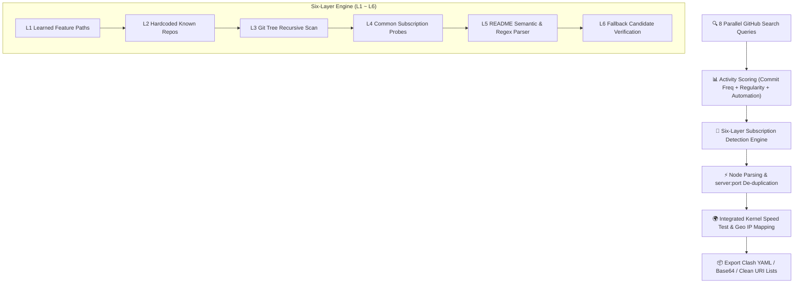

<div align="center">

# ProxyNodeHub

### GitHub Free-Node Repository Monitor & Intelligent Aggregator

**English** | [中文](README.md)

<p align="center">
  
  
  
  
  <a href="https://linux.do" target="_blank"></a>
</p>


</div>

---

> [!TIP]
> ⭐ **If ProxyNodeHub is useful to you, please consider giving it a Star — it is the biggest motivation to maintain and advance this project.**

---

## 📖 Overview

**ProxyNodeHub** finds active free-node repositories on GitHub: it evaluates their activity, detects subscription links using a six-layer engine, de-duplicates nodes across repositories, and exports clean merged subscriptions. One click on **Search & analyse**, and the triage is done for you.

No more opening repository after repository, manually comparing configurations, or stitching links together. ProxyNodeHub surfaces well-maintained and frequently updated repositories, while also digging out quiet, obscure treasures — in the public node sphere, lower profile usually means lower load and prolonged uptime.

---

## 🚀 Detection Architecture & Workflow



---

## ✨ Features

| Feature | Description |
|:---|:---|
| **Six-Layer Detection Engine** | Feature library → hardcoded mapping → file-tree scan → common-path probe → README parse → fallback candidates |
| **Concurrent Search** | 8 keyword queries issued in parallel across GitHub's REST API for rapid discovery |
| **Activity Scoring** | 100-point model evaluated over commit frequency (7d), regularity, workflow automation, and obscurity |
| **Intelligent De-duplication** | Exact de-duplication keyed on `server:port` across multiple subscriptions |
| **Four Processing Modes** | 🚀 **Turbo** / ⚖️ **Standard** / 🔍 **Deep** / 🐢 **Compatible**, each with tuned concurrency |
| **Mirror Latency Test** | 13 acceleration mirrors with automatic speed tests, failover, and 5-minute dynamic caching |
| **Search-History Filter** | Recently searched repositories skipped automatically (1–30 days adjustable) |
| **Favourites** | Dedicated favourites management view, persisted across restarts and container rebuilds |
| **Self-Learning Library** | Remembers paths that succeeded previously to speed up future runs |
| **Modern Adaptive Web UI** | High-tech Web console with automatic dark/light theme, world map dashboard, and live terminal |

---

## 💻 Requirements

- **Self-contained desktop build** — Windows 10 or later (x64). Zero prerequisites.
- **Framework-dependent desktop build** — Windows 10 or later (x64) plus [.NET 8 Desktop Runtime](https://dotnet.microsoft.com/download/dotnet/8.0).
- **Docker image** — Linux (`amd64` / `arm64`), no Windows required. Includes both the Web UI and batch CLI.

---

## ⚡ Quick Start

### Windows Desktop

1. Download the latest release from [Releases](../../releases) (`ProxyNodeHub_vX.X.X_self-contained.zip` recommended).
2. Unzip anywhere and run `ProxyNodeHub.exe`.
3. Press **F5** (or click **Search & analyse**) to begin.

> [!NOTE]
> Setting a GitHub Personal Access Token is optional but highly recommended: increases API rate limits from 60/hr to 5,000/hr. Tokens are securely encrypted via Windows Credential Manager.

---

## 🐳 Docker Deployment

The container provides both a **modern Web management console** and a command-line interface. The Web UI features responsive dark/light mode switching and interactive geographic distribution maps:

### 1. Launch Web Console

```bash
# Start container in background
docker compose up -d

# Open Web management console in browser
open http://localhost:8080
```

### 2. Multi-Arch Build (Optional)

```bash
# Build for host architecture
docker build -t pnodes .

# Build multi-platform image (amd64 + arm64)
docker buildx build --platform linux/amd64,linux/arm64 -t pnodes .
```

---

### 🌐 Web Console Views

| View | Capabilities |
|:---|:---|
| 🌍 **Node Distribution** | Interactive world map showing city clusters and residential vs datacenter IP classification |
| 🔍 **Search & Analyse** | Keyword search, multi-factor scoring, subscription discovery, real-time filtering, merging & exporting |
| ⭐ **Favourites** | Separate dedicated view for starred repositories, persisted on volume across rebuilds |
| ⚡ **Speed Test** | Three-step progressive flow: load catalog → filter & select → test & export |
| ⚙️ **Settings** | GitHub token, default search thresholds, subscription converter endpoint, ipinfo token, and kernel concurrency |

A collapsible **Live Terminal Drawer** at the bottom streams real-time kernel output and pipeline diagnostics via Server-Sent Events (SSE).

---

### ⚡ Progressive Speed Testing

To avoid bandwidth waste and long waits across thousands of nodes, testing is split into three deliberate stages:

1. **Load Node Catalog**: Lightweight HTTP fetch and URI parse in seconds. No kernel spawned; zero speedtest bandwidth consumed.
2. **Filter & Select**:
   - **Regex Name Filter**: Filter by regex pattern (e.g. `^🇺🇸`, `(HK|SG|JP)`, `:443$`), with automatic fallback to text substring on syntax errors.
   - **Protocol Multi-Select**: Filter by protocols (`vless`, `vmess`, `trojan`, `ss`, `ssr`, `hy2`, `tuic`).
   - **Source Multi-Select**: Filter by origin repository.
3. **Test Selected Nodes**: Hand only selected nodes to the kernel for bandwidth/delay benchmarking and export to Clash YAML.

---

### 🛠️ CLI Batch Mode

The same image supports batch execution for cron jobs or CI/CD pipelines:

```bash
# Search and merge nodes, saving results to /data/output
docker run --rm -v pnodes-data:/data -e GITHUB_TOKEN=ghp_xxx pnodes search -n 30

# Speedtest an existing subscription
docker run --rm -v pnodes-data:/data pnodes speedtest https://example.com/sub

# Merge existing subscriptions without searching
docker run --rm -v pnodes-data:/data pnodes merge https://example.com/sub1 https://example.com/sub2
```

| Command | Action |
|:---|:---|
| `web` | Launch Web management interface (default container CMD) |
| `search` | Search repositories → score activity → detect subs → merge & de-duplicate |
| `merge <URL...>` | Merge subscriptions without searching |
| `speedtest <URL...>` | Benchmark nodes with kernel and export passing results |
| `kernel [status\|install]` | Check or install the embedded subs-check kernel |
| `doctor` | Diagnose environment, permissions, volume mounts, and token validity |

---

## ⌨️ Desktop Shortcuts

| Shortcut | Action |
|:---|:---|
| `F5` | Start / cancel search |
| `Ctrl + C` | Copy top subscription link of selected row |
| `Ctrl + L` | Toggle details drawer |
| `Ctrl + D` | Toggle favourites view |
| `Ctrl + F` | Focus filter input |
| `Esc` | Close dialog or details drawer |

---

## 📁 Repository Layout

```
src/
├── ProxyNodeHub.Core/            # Cross-platform Core library (.NET 8, no UI dependencies)
│   ├── SearchPipeline.cs         # Search → profile → filter → merge orchestration pipeline
│   ├── SubscriptionFinder.cs     # Six-layer subscription detection engine
│   ├── GitHubService.cs          # REST API client with 13-mirror auto-benchmarking
│   ├── GitHubAnalyzer.cs         # Scoring algorithm, bot detection & commit frequency analytics
│   ├── NodeParser.cs             # URI parser, fingerprint generator & de-duplicator
│   ├── SpeedTestRunner.cs        # Embedded subs-check kernel controller & bridge
│   ├── SpeedTestConfig.cs        # Comment-preserving YAML configuration manager
│   └── IpInfoService.cs          # IP geolocation & residential classification service
│
├── ProxyNodeHub.Cli/             # Cross-platform CLI / Container Web daemon
│   ├── Program.cs                # CLI command routing
│   ├── WebServer.cs              # ASP.NET Core minimal APIs & embedded static assets
│   ├── WebState.cs               # Shared state machine & persistence layer
│   └── wwwroot/                  # Modern tech Web frontend (vanilla, zero build tools)
│
├── Program.cs / MainForm.cs      # Windows desktop WinForms presentation layer
└── Theme.cs / Fonts.cs           # Desktop color tokens & typography
```

---

## 📄 License

Distributed under the [MIT License](LICENSE).
