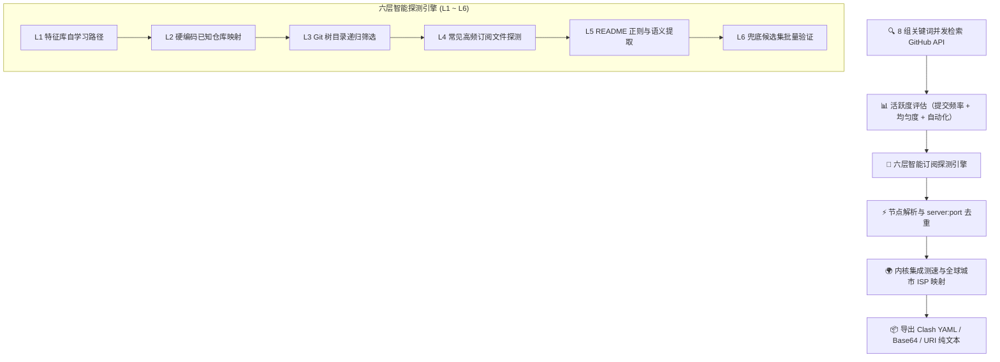

<div align="center">

# ProxyNodeHub

### GitHub 免费节点仓库监控与智能聚合工具

[English](README.en.md) | **中文**

<p align="center">
  
  
  
  
  <a href="https://linux.do" target="_blank"></a>
</p>


</div>

---

> [!TIP]
> ⭐ **如果 ProxyNodeHub 对你有用，请务必点一个 Star，这是持续维护这个项目最大的动力。**

---

## 📖 项目简介

**ProxyNodeHub** 专为发现 GitHub 上活跃的免费节点仓库而设计：多维分析仓库活跃度、六层探测订阅、去重分散节点、自动聚合导出。一键点击「搜索并分析」，全流程自动化处理。

告别逐个仓库翻找、比对、手动拼接订阅的繁琐操作。它既能挑出更新最勤、维护最稳的顶级仓库，也能翻出藏在角落不易察觉的冷门宝藏仓库——在公共节点领域，低调往往意味着更低负载与更长存活周期。

---

## 🚀 核心架构与探测流程



---

## ✨ 功能特性

| 模块 | 特性说明 |
|:---|:---|
| **六层探测引擎** | 特征库学习 → 硬编码映射 → 文件树筛选 → 常见路径探测 → README 解析 → 兜底候选 |
| **高并发搜索** | 8 个关键词并发请求 GitHub REST API，快速网罗潜在候选仓库 |
| **活跃度评分** | 提交频率 (7d) + 提交均匀度 + 自动化工作流 + 隐蔽度，综合 100 分制 |
| **智能节点去重** | 以 `server:port` 为键精密去重，消除跨仓库重复节点冗余 |
| **四种处理模式** | 🚀 **极速** / ⚖️ **标准** / 🔍 **深度** / 🐢 **兼容**，各模式具备独立并发度调度 |
| **镜像自动测速** | 内置 13 个 GitHub 加速镜像，自动测速、失效回退、5 分钟结果动态缓存 |
| **历史过滤机制** | 已搜索过的仓库自动跳过（1–30 天区间可调），避免重复请求 API |
| **常用收藏夹** | 独立收藏夹管理视图，支持持久化存储与一键调入测速清单 |
| **特征库自进化** | 自动记忆并固化探测成功过的路径规则，后续扫描直接命中 |
| **深浅自适应 Web 控制台** | Docker 镜像自带科技感现代 Web 管理界面，支持全球地图可视化与实时终端 |

---

## 💻 运行环境

- **自包含桌面版** — Windows 10 及以上（x64），已包含所需运行时，解压即用。
- **框架依赖桌面版** — Windows 10 及以上（x64），需预装 [.NET 8 Desktop Runtime](https://dotnet.microsoft.com/download/dotnet/8.0)。
- **Docker 容器版** — Linux（支持 `amd64` / `arm64`），自带 Web 控制台与批处理 CLI。

---

## ⚡ 快速开始

### Windows 桌面版

1. 前往 [Releases](../../releases) 下载最新版本（推荐首选无需运行时的 `ProxyNodeHub_vX.X.X_self-contained.zip`）。
2. 解压到任意目录，双击启动 `ProxyNodeHub.exe`。
3. 按下快捷键 **F5**（或点击「搜索并分析」）即可一键开始。

> [!NOTE]
> GitHub Token 为可选项但强烈推荐填写：匿名搜索 API 每小时限额 60 次，填入后将提升至 5000 次/小时。令牌经 Windows 凭据管理器加密存储。

---

## 🐳 Docker 容器部署

容器版提供**现代化 Web 管理界面**与命令行批处理两种形态，界面支持深浅色自适应切换与全球节点分布可视化：

### 1. 启动 Web 控制台

```bash
# 一键拉取并后台启动容器
docker compose up -d

# 浏览器访问 Web 管理控制台
open http://localhost:8080
```

### 2. 多架构镜像构建 (可选)

```bash
# 本机架构快速构建
docker build -t pnodes .

# 多架构构建 (amd64 + arm64 一次成型)
docker buildx build --platform linux/amd64,linux/arm64 -t pnodes .
```

---

### 🌐 Web 控制台主要功能页

| 页签 | 核心功能 |
|:---|:---|
| 🌍 **节点分布** | 交互式全球城市地理分布图，直观区分家宽（Residential）与机房（Datacenter）节点 |
| 🔍 **搜索分析** | 关键词检索、活跃度多维打分、订阅源探测、多字段实时筛选、收藏与批量合并 |
| ⭐ **收藏夹** | 常用优质仓库专属视图，重启或容器升级后数据持久保留 |
| ⚡ **节点测速** | 三步式轻量流程：拉取清单 → 正则/协议多维勾选 → 真实内核测速与导出 |
| ⚙️ **系统设置** | GitHub Token、搜索默认参数、转换后端端点、ipinfo API、测速并发与流媒体检测 |

底部集成可折叠的**实时运行终端抽屉**，内核输出与管线日志通过 SSE 实时推送。

---

### ⚡ 测速机制：按需加载，精准测速

为了避免数千节点全量测速带来的流量浪费与数小时等待，测速界面采用三步渐进设计：

1. **加载节点清单**：仅通过轻量拉取并解析订阅文本，几秒内完成，不产生任何测速流量。
2. **多维筛选与勾选**：
   - **名称正则模式**：支持正则匹配（如 `^🇺🇸`、`(HK|SG|JP)`、`:443$`），语法错误时自动平滑回退至纯文本搜索。
   - **协议多选标签**：支持 `vless` / `vmess` / `trojan` / `ss` / `ssr` / `hy2` / `tuic` 组合筛选。
   - **来源仓库多选**：按提取来源精准分流。
3. **测速选中节点**：将筛选后的节点注入内置测速内核，真实测试延迟、带宽并导出通过的 Clash YAML 节点。

---

### 🛠️ CLI 批处理模式

同一容器镜像完整支持命令行调用，可与 cron 或 CI/CD 无缝集成：

```bash
# 搜索并合并去重，结果持久化至 /data/output
docker run --rm -v pnodes-data:/data -e GITHUB_TOKEN=ghp_xxx pnodes search -n 30

# 针对已有订阅文件进行快速测速
docker run --rm -v pnodes-data:/data pnodes speedtest https://example.com/sub

# 纯粹合并与去重已有的多个订阅
docker run --rm -v pnodes-data:/data pnodes merge https://example.com/sub1 https://example.com/sub2
```

| 命令行子命令 | 说明 |
|:---|:---|
| `web` | 启动 Web 管理界面 (容器默认 CMD) |
| `search` | 搜索仓库 → 分析活跃度 → 探测订阅 → 合并去重 |
| `merge <URL...>` | 快速合并去重，不执行搜索 |
| `speedtest <URL...>` | 调用 subs-check 测速内核，输出可用节点 |
| `kernel [status\|install]` | 检查或升级测速内核（镜像已预装） |
| `doctor` | 运行环境诊断：平台架构、存储卷挂载、Token 有效性 |

---

## ⌨️ 快捷键指南

| 快捷键 | 桌面端功能 |
|:---|:---|
| `F5` | 开始 / 取消全局搜索 |
| `Ctrl + C` | 复制当前选中行的最佳订阅链接 |
| `Ctrl + L` | 展开 / 折叠详情面板 |
| `Ctrl + D` | 快速切入 / 切出收藏夹 |
| `Ctrl + F` | 快速聚焦筛选输入框 |
| `Esc` | 关闭当前弹窗或详情面板 |

---

## 📁 目录与持久化架构

```
src/
├── ProxyNodeHub.Core/            # 跨平台核心库 (.NET 8，无 GUI 依赖)
│   ├── SearchPipeline.cs         # 搜索 → 分析 → 过滤 → 合并的核心工作管线
│   ├── SubscriptionFinder.cs     # 六层智能订阅探测引擎实现
│   ├── GitHubService.cs          # REST API 访问与 13 个镜像自适应测速
│   ├── GitHubAnalyzer.cs         # 活跃度、Bot 检测及提交频率打分
│   ├── NodeParser.cs             # 节点 URI 解析、指纹比对与精准去重
│   ├── SpeedTestRunner.cs        # subs-check 嵌入式测速内核调度器
│   ├── SpeedTestConfig.cs        # Session 配置保留格式读写
│   └── IpInfoService.cs          # 出口 IP 地理位置与家宽属性查询服务
│
├── ProxyNodeHub.Cli/             # 跨平台 CLI / 容器 Web 服务
│   ├── Program.cs                # 命令行 CLI 命令入口
│   ├── WebServer.cs              # ASP.NET Core 极简 Web API 与静态内嵌服务
│   ├── WebState.cs               # 共享生命周期与持久化状态机
│   └── wwwroot/                  # 现代化科技风 Web 前端 (原生极速体验)
│
├── Program.cs / MainForm.cs      # Windows 桌面版 WinForms 界面与交互系统
└── Theme.cs / Fonts.cs           # 桌面端视觉令牌与字体体系
```

---

## 📄 许可证

本项目基于 [MIT License](LICENSE) 开源。
